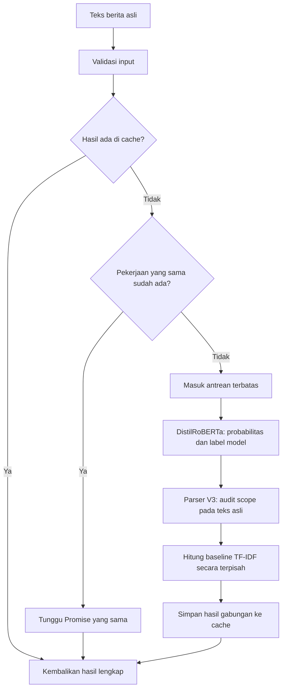

# Cara kerja model sentimen IRIS

Folder ini menyimpan Financial DistilRoBERTa dalam format ONNX FP32. Pipeline
lengkapnya menggabungkan prediksi neural dengan aturan IRIS Semantic Parser V3,
serta menghitung TF-IDF + Logistic Regression sebagai baseline terpisah.
Seluruh inferensi berjalan di backend Node.js melalui ONNX Runtime CPU.

## Komponen dan perannya

| Komponen | Peran |
|---|---|
| [model.onnx](model.onnx) | Bobot Financial DistilRoBERTa, FP32, opset 17; disimpan melalui Git LFS |
| [config.json](config.json) | Arsitektur dan pemetaan kelas: `negative`, `neutral`, `positive` |
| [tokenizer.json](tokenizer.json) | Byte-level BPE dan pemrosesan token RoBERTa |
| [manifest.json](manifest.json) | Identitas versi, batas token, ukuran dan hash aset untuk validasi startup |
| [parser.mjs](../../node/parser.mjs) | Ekstraksi bukti dari teks asli dan kebijakan scope V3 |
| [model.node.json](../tfidf/model.node.json) | Vocabulary, IDF dan koefisien baseline yang sudah dilatih sebelumnya |

Model neural berasal dari
`mrm8488/distilroberta-finetuned-financial-news-sentiment-analysis`, revision
`ae0eab9ad336d7d548e0efe394b07c04bcaf6e91`. Arsitekturnya memiliki 6 Transformer
layer, hidden size 768, dan 12 attention head. Model upstream sudah di-fine-tune
pada berita finansial berbahasa Inggris dari Financial PhraseBank; lihat
[kartu model upstream](../../UPSTREAM-MODEL-CARD.md).

Integrasi ini mengekspor bobot yang sama ke ONNX FP32. Tidak ada training ulang,
quantization, atau penggabungan bobot dengan parser maupun TF-IDF.

## Alur dari berita ke hasil

1. **Validasi dan pembersihan.** API menerima 1–40 artikel dengan `id` unik dan
   `text`. Teks asli tetap disimpan. Untuk model, URL, mention, serta banner awal
   seperti `JUST IN:` atau `BREAKING:` dihapus dan whitespace dirapikan. Teks
   neural mempertahankan kapitalisasi. Parser menggunakan teks asli; bagian
   yang diabaikan dimask agar offset bukti tetap menunjuk ke teks tersebut.
2. **Tokenisasi.** Byte-level BPE mengubah teks menjadi ID subword, kemudian
   menambahkan token khusus RoBERTa. Batas input adalah 512 token termasuk token
   khusus. Input lebih panjang dipotong dari kanan dengan token penutup tetap
   dipertahankan. Dalam satu batch, padding mengikuti teks terpanjang dan
   `attention_mask` menandai token yang perlu diperhatikan model.
3. **Inferensi neural.** ONNX menerima `input_ids` dan `attention_mask`, lalu
   menghasilkan tiga logit. Softmax mengubahnya menjadi probabilitas tiga kelas
   yang berjumlah sekitar 1. Kelas dengan probabilitas terbesar disimpan sebagai
   `model_sentiment`. Ini adalah sentimen keseluruhan teks, bukan prediksi harga
   atau probabilitas naik/turunnya Bitcoin.
4. **Audit parser V3.** Parser memeriksa siapa pemegang stance, apa targetnya,
   scope negasi, arah usulan, serta hubungan stance dan waktu dalam pola kalimat
   yang didukung. Bila scope memenuhi aturan, label akhir mengikuti kandidat
   parser. Bila parser abstain, label neural dipertahankan. Parser tidak
   menghitung ulang probabilitas neural.
5. **Baseline dan respons.** TF-IDF mengubah teks menjadi fitur kata unigram dan
   bigram, menerapkan bobot IDF dan normalisasi L2, lalu Logistic Regression
   menghitung probabilitasnya sendiri. Vocabulary dan koefisien berasal dari
   model baseline lama. Baseline dikembalikan pada field terpisah tanpa voting
   atau rata-rata dengan hasil neural. Respons lengkap kemudian disimpan di cache.

## Kapan parser mengubah label?

Parser V3 memakai pola seluruh teks dengan subjek dan target yang dibatasi
secara eksplisit. Ia mendukung beberapa bentuk stance, klaim manfaat dengan
negasi, stance terhadap usulan treasury, dan arah usulan seperti mengizinkan
atau melarang layanan kripto. Untuk relative clause, koreksi hanya diterapkan
jika holder/target/aspek konsisten dan stance kompatibel, atau terdapat transisi
historis ke stance sekarang yang eksplisit.

Rumor, penyangkalan, kondisi yang tidak didukung, konflik target/aspek, banyak
aset, pola konteks yang tidak dikenali, atau input yang terpotong dapat membuat
parser abstain. Ini adalah aturan dengan cakupan terbatas; parser bukan
penyelesai coreference umum atau pemeriksa kebenaran berita. Stance yang berhasil
diekstrak juga tidak membuktikan bahwa peristiwa tersebut benar-benar terjadi.

Contoh berikut sudah diperiksa dengan pipeline yang berjalan:

| Teks | Label neural | Keputusan V3 | Label akhir |
|---|---|---|---|
| `The bank supports Bitcoin adoption.` | `neutral` | Dukungan eksplisit pada target yang didukung | `positive` |
| `An association which criticizes crypto adoption opposes crypto adoption.` | `neutral` | Stance negatif kompatibel pada holder dan target yang sama | `negative` |
| `The bank denies a rumor that it supports Bitcoin adoption.` | `neutral` | Abstain: `denial_rumor_or_conditional_scope` | `neutral` |

Contoh ini menjelaskan perilaku aturan, bukan ukuran akurasi model pada berita
umum. Semua hasil kebijakan V3 saat ini ditandai `needs_review=true`, baik ketika
aturan diterapkan maupun ketika abstain, sesuai status aturan pengembangan.
`uncertain` pada anotasi manusia tidak menjadi kelas output baru: model tetap
menghasilkan tiga kelas dan ketidakpastian ditunjukkan melalui metadata review.

## Membaca output

| Field | Arti |
|---|---|
| `prediction.model_sentiment` | Label neural sebelum kebijakan parser |
| `prediction.sentiment` | Label akhir setelah kebijakan V3 |
| `prediction.probabilities` | Probabilitas neural asli; tetap sama setelah koreksi parser |
| `prediction.probabilities_basis` | `unmodified_model_only`, sehingga skor tidak disalahartikan sebagai skor gabungan |
| `prediction.sentiment_adjustment.eligible` | Aturan parser diterapkan pada contoh ini |
| `prediction.sentiment_adjustment.changed` | Label akhir berbeda dari label neural |
| `prediction.sentiment_adjustment.evidence` | Cue, target, dan span teks yang mendasari keputusan |
| `prediction.sentiment_adjustment.abstention_reason` | Alasan parser menahan koreksi |
| `prediction.semantic_parse` | Entity, event, negasi, modality, serta bukti dengan offset Unicode codepoint |
| `prediction.inference.truncated` | Input neural melewati batas token dan dipotong |
| `prediction.needs_review` / `review_reasons` | Status review dan alasannya; bukan kelas sentimen |
| `baseline` | Label dan probabilitas TF-IDF + Logistic Regression yang independen |

Penyebutan BTC dan informasi semantik tersedia sebagai konteks terpisah.
Pipeline ini tidak mengubah berita makro atau harga aset lain menjadi label
`effect_to_btc`. Skor gabungan berita + Fear & Greed di panel terminal juga
dihitung di lapisan aplikasi, bukan di bobot ONNX ini.

## Cache dan concurrency

Saat worker mulai, aset diverifikasi lalu model, tokenizer dan baseline dimuat
sekali. Scheduler memakai kunci dari teks asli dan fingerprint pipeline yang
mencakup bobot, tokenizer, kode parser, baseline, versi runtime dan konfigurasi
thread. Perubahan pipeline menghasilkan identitas cache yang berbeda.

Cache menyimpan hasil yang sudah selesai. `inFlight` menyimpan Promise pekerjaan
yang masih antre atau berjalan. Pekerjaan didaftarkan sebelum operasi async,
sehingga request identik berbagi satu pekerjaan. Default-nya satu batch aktif,
maksimal 8 teks per batch, antrean 128 teks unik, dan cache TTL/LRU berisi maksimal
2048 hasil selama satu jam. Error tidak disimpan sebagai prediksi. Identitas
artikel milik pemanggil dipasang setelah hasil bersama diperoleh.

Cache dan model berlaku per proses; beberapa replica memerlukan koordinasi
tambahan. Empat thread CPU di dalam ONNX berbeda dari empat batch bersamaan.
Lihat [README layanan](../../README.md) untuk konfigurasi, API, cara menjalankan,
Git LFS, dan `npm run check`.

Kode alur inferensi: [model.mjs](../../node/model.mjs). Kode pengelolaan pekerjaan:
[scheduler.mjs](../../node/scheduler.mjs). Pemeriksaan kesetaraan memakai 66 contoh
sintetis dan uji HTTP memakai 32 request bersamaan. Hasil itu adalah diagnostik
konversi/integrasi, terpisah dari metrik gold manusia; gold/holdout tidak dipakai
untuk training atau tuning pipeline ini.
