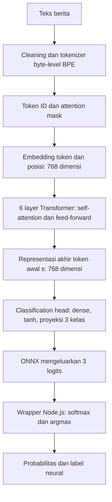

# Cara kerja internal Financial DistilRoBERTa

Financial DistilRoBERTa mengubah teks berita menjadi representasi angka yang
memuat konteks, lalu mengklasifikasikannya sebagai `negative`, `neutral`, atau
`positive`. Bagian berikut menjelaskan pekerjaan jaringan neural itu sendiri.
Parser V3, baseline, dan cache dijelaskan setelah mekanisme neural karena
ketiganya merupakan komponen terpisah dari bobot model.

## Model yang dipakai

Checkpoint yang digunakan adalah
[`mrm8488/distilroberta-finetuned-financial-news-sentiment-analysis`](https://huggingface.co/mrm8488/distilroberta-finetuned-financial-news-sentiment-analysis),
revision `ae0eab9ad336d7d548e0efe394b07c04bcaf6e91`. Model upstream sudah
di-fine-tune pada Financial PhraseBank berbahasa Inggris; salinan penjelasannya
tersedia di [kartu model upstream](../../UPSTREAM-MODEL-CARD.md).

Dimensi berikut berasal dari [config.json](config.json) checkpoint ini:

| Bagian | Konfigurasi |
|---|---|
| Arsitektur | `RobertaForSequenceClassification` |
| Encoder | 6 layer Transformer bidirectional |
| Ukuran representasi setiap token | 768 angka |
| Self-attention | 12 head per layer, masing-masing berdimensi 64 |
| Feed-forward per layer | 768 → 3072 → 768, aktivasi GELU |
| Vocabulary | 50.265 token |
| Kelas output sesuai urutan indeks | 0 = `negative`, 1 = `neutral`, 2 = `positive` |
| Batas input layanan | 512 token termasuk token khusus |
| Format inferensi | ONNX FP32, opset 17, ONNX Runtime CPU di Node.js |

## Dari teks menjadi prediksi



### 1. Tokenisasi: teks menjadi ID subword

Wrapper menghapus URL, mention, dan banner awal seperti `JUST IN:` atau
`BREAKING:`, lalu merapikan whitespace. Kapitalisasi tetap dipertahankan.
Tokenizer **byte-level BPE** memecah teks menjadi token yang bisa berupa kata,
bagian kata, atau tanda baca. Token kemudian dipetakan ke ID vocabulary; satu
token tidak selalu sama dengan satu kata. Metode tokenisasi ini mengikuti
[RoBERTa](https://huggingface.co/docs/transformers/model_doc/roberta).

Token `<s>` ditambahkan di awal dan `</s>` di akhir. Tensor `input_ids` berisi
ID tersebut, sedangkan `attention_mask` menandai token asli dengan 1 dan padding
dengan 0. Dalam satu batch, padding mengikuti input terpanjang. Input melewati
512 token dipotong dari kanan dengan `</s>` tetap dipertahankan; konteks yang
dibuang tidak bisa digunakan model. Nilai `max_position_embeddings=514` pada
config adalah ukuran tabel posisi RoBERTa, bukan izin membaca 514 token teks.

### 2. Embedding: setiap token menjadi vektor

ID token digunakan untuk mengambil vektor yang sudah dipelajari dari tabel
embedding. Vektor token dijumlahkan dengan embedding posisi agar urutan kata
terwakili. Implementasi juga memiliki satu embedding tipe segmen yang sama
untuk seluruh input, sehingga tidak membedakan pasangan segmen. Hasilnya
dinormalisasi dengan LayerNorm.

Setiap posisi sekarang memiliki **768 angka**. Untuk batch berukuran `B` dengan
panjang setelah padding `L`, bentuk representasinya adalah `[B, L, 768]`.
Angka-angka ini merupakan fitur yang dipelajari, bukan label kata yang
ditentukan manual.

### 3. Enam layer Transformer: membangun konteks

Pada setiap layer, **self-attention** menghitung hubungan antartoken dalam
seluruh input yang tersedia. Sifat bidirectional memungkinkan satu token
menggunakan konteks sebelum dan sesudahnya. Ini memberi model kemampuan
membedakan konteks seperti kenaikan laba dan penyangkalan kenaikan laba,
meskipun tidak menjamin negasi selalu ditafsirkan dengan benar.

Untuk setiap head, representasi input `H` diproyeksikan dengan bobot terlatih:

```text
Q = H Wq        K = H Wk        V = H Wv
attention(Q, K, V) = softmax(Q Kᵀ / sqrt(64) + M) V
```

`Q` dan `K` menentukan bobot hubungan antartoken; `V` membawa informasi yang
digabungkan. `M` adalah mask yang menutup posisi padding. Ada 12 head dengan
dimensi 64, sehingga beberapa proyeksi hubungan dapat dihitung bersamaan.
Hasilnya digabung dan diproyeksikan kembali menjadi 768 dimensi.

Setelah attention, terdapat residual connection dan LayerNorm. Berikutnya,
jaringan feed-forward mengolah setiap posisi melalui
`768 → 3072 → GELU → 768`, diikuti residual connection dan LayerNorm lagi.
Rangkaian ini diulang enam kali. Keluaran akhirnya masih `[B, L, 768]`, tetapi
representasi setiap token sudah dipengaruhi konteks token lain.

Bobot attention tidak otomatis menjadi penjelasan sebab prediksi. Ekspor ONNX
layanan ini mengeluarkan logits, bukan heatmap atau penjelasan kata per kata.

### 4. Classification head: representasi konteks menjadi tiga logits

Classifier mengambil representasi akhir **token pertama `<s>`**, bukan rata-rata
seluruh token. Melalui training klasifikasi, representasi ini digunakan untuk
keputusan pada tingkat keseluruhan input. Alurnya:

```text
representasi <s> [768]
  → dense [768 → 768]
  → tanh
  → proyeksi output [768 → 3]
  → logits [negative, neutral, positive]
```

Arsitektur training menempatkan dropout sebelum dense dan sebelum proyeksi
output. Dropout dinonaktifkan saat inferensi. Struktur head ini mengikuti
[implementasi RoBERTa di Transformers](https://github.com/huggingface/transformers/blob/v4.57.6/src/transformers/models/roberta/modeling_roberta.py#L1426).

Logits adalah skor mentah yang belum dibatasi antara 0 dan 1. ONNX menerima
`input_ids` dan `attention_mask` berbentuk `[B, L]`, lalu mengembalikan tensor
`logits` berbentuk `[B, 3]`.

### 5. Softmax: skor menjadi probabilitas kelas

Wrapper [model.mjs](../../node/model.mjs) menerapkan softmax pada tiga logits.
Softmax di sini terpisah dari softmax attention pada langkah 3: yang ini
menormalisasi skor **kelas sentimen**, bukan hubungan antartoken.

```text
p(k) = exp(z[k] - max(z)) / sum_j(exp(z[j] - max(z)))
label neural = kelas dengan p(k) terbesar
```

Pengurangan nilai maksimum menjaga stabilitas numerik tanpa mengubah hasil
matematis. Sebagai ilustrasi perhitungan, bukan hasil inferensi berita tertentu:

| Kelas | Logit ilustratif | Probabilitas softmax |
|---|---:|---:|
| negative | -1 | 0,0420 |
| neutral | 0 | 0,1142 |
| positive | 2 | 0,8438 |

Pada ilustrasi ini labelnya `positive`. Nilai 0,8438 menyatakan skor relatif
kelas dari model; belum ada bukti kalibrasi bahwa nilai tersebut berarti
84,38% peluang prediksi benar pada berita IRIS. Model tetap memilih satu dari
tiga kelas, sehingga `uncertain` pada anotasi manusia bukan kelas output neural.

## Dari mana model belajar?

Model dasar
[DistilRoBERTa](https://huggingface.co/distilbert/distilroberta-base)
merupakan hasil distillation RoBERTa-base: jaringan yang lebih kecil dilatih
untuk meniru perilaku teacher dan mempelajari representasi bahasa. Model dasar
ini memiliki sekitar 82 juta parameter dan enam layer. Upstream kemudian
melakukan fine-tuning untuk klasifikasi sentimen finansial menggunakan contoh
berlabel dari Financial PhraseBank. Parameter jaringan dan head menyesuaikan
diri terhadap tugas tersebut.

Integrasi IRIS memakai checkpoint hasil fine-tuning itu dan mengekspornya ke
ONNX FP32. **Saat berita masuk, bobot tetap:** layanan hanya melakukan forward
pass di atas. Tidak ada training ulang, pembelajaran dari request, quantization,
atau pemakaian gold/holdout untuk memperbarui bobot. Distillation terjadi saat
pembuatan model dasar; FP32 adalah presisi angka saat menjalankan model ini.

Model menilai sentimen finansial teks sesuai pola yang dipelajarinya. Kenaikan
harga minyak bisa bernada positif untuk minyak tanpa menentukan efeknya pada
BTC. Teks yang ambigu, berbeda domain, memuat banyak aset, atau kehilangan
konteks akibat truncation dapat menghasilkan prediksi keliru. Model ini tidak
mengambil data pasar baru, memeriksa kebenaran berita, atau meramal harga BTC.

## Berkas model dan komponen di luar jaringan

| Komponen | Peran |
|---|---|
| [model.onnx](model.onnx) | Bobot Financial DistilRoBERTa, FP32, opset 17; disimpan melalui Git LFS |
| [config.json](config.json) | Arsitektur dan pemetaan kelas: `negative`, `neutral`, `positive` |
| [tokenizer.json](tokenizer.json) | Byte-level BPE dan pemrosesan token RoBERTa |
| [manifest.json](manifest.json) | Identitas versi, batas token, ukuran dan hash aset untuk validasi startup |
| [parser.mjs](../../node/parser.mjs) | Ekstraksi bukti dari teks asli dan kebijakan scope V3 |
| [model.node.json](../tfidf/model.node.json) | Vocabulary, IDF dan koefisien baseline yang sudah dilatih sebelumnya |

`model.onnx` menyimpan graph komputasi dan bobot terlatih. Tokenizer merupakan
aset pendamping untuk menyiapkan input. Parser V3 memeriksa teks asli dan dapat
mengubah label akhir setelah prediksi neural dihitung; probabilitas neural
tetap sama. TF-IDF + Logistic Regression memakai vocabulary, IDF, normalisasi
L2, dan koefisiennya sendiri untuk menghasilkan baseline independen. Tidak ada
penggabungan bobot, voting, atau rata-rata probabilitas antarkedua model.

## Kapan parser mengubah label?

Parser V3 memakai pola seluruh teks dengan subjek dan target yang dibatasi
secara eksplisit. Ia mendukung beberapa bentuk stance, klaim manfaat dengan
negasi, stance terhadap usulan treasury, dan arah usulan seperti mengizinkan
atau melarang layanan kripto. Untuk relative clause, koreksi hanya diterapkan
jika holder/target/aspek konsisten dan stance kompatibel, atau terdapat transisi
historis ke stance sekarang yang eksplisit.

Rumor, penyangkalan, kondisi yang tidak didukung, konflik target/aspek, banyak
aset, pola konteks yang tidak dikenali, atau input yang terpotong dapat membuat
parser abstain. Ini adalah aturan dengan cakupan terbatas; parser bukan
penyelesai coreference umum atau pemeriksa kebenaran berita. Stance yang berhasil
diekstrak juga tidak membuktikan bahwa peristiwa tersebut benar-benar terjadi.

Contoh berikut sudah diperiksa dengan pipeline yang berjalan:

| Teks | Label neural | Keputusan V3 | Label akhir |
|---|---|---|---|
| `The bank supports Bitcoin adoption.` | `neutral` | Dukungan eksplisit pada target yang didukung | `positive` |
| `An association which criticizes crypto adoption opposes crypto adoption.` | `neutral` | Stance negatif kompatibel pada holder dan target yang sama | `negative` |
| `The bank denies a rumor that it supports Bitcoin adoption.` | `neutral` | Abstain: `denial_rumor_or_conditional_scope` | `neutral` |

Contoh ini menjelaskan perilaku aturan, bukan ukuran akurasi model pada berita
umum. Semua hasil kebijakan V3 saat ini ditandai `needs_review=true`, baik ketika
aturan diterapkan maupun ketika abstain, sesuai status aturan pengembangan.
`uncertain` pada anotasi manusia tidak menjadi kelas output baru: model tetap
menghasilkan tiga kelas dan ketidakpastian ditunjukkan melalui metadata review.

## Membaca output

| Field | Arti |
|---|---|
| `prediction.model_sentiment` | Label neural sebelum kebijakan parser |
| `prediction.sentiment` | Label akhir setelah kebijakan V3 |
| `prediction.probabilities` | Probabilitas neural asli; tetap sama setelah koreksi parser |
| `prediction.probabilities_basis` | `unmodified_model_only`, sehingga skor tidak disalahartikan sebagai skor gabungan |
| `prediction.sentiment_adjustment.eligible` | Aturan parser diterapkan pada contoh ini |
| `prediction.sentiment_adjustment.changed` | Label akhir berbeda dari label neural |
| `prediction.sentiment_adjustment.evidence` | Cue, target, dan span teks yang mendasari keputusan |
| `prediction.sentiment_adjustment.abstention_reason` | Alasan parser menahan koreksi |
| `prediction.semantic_parse` | Entity, event, negasi, modality, serta bukti dengan offset Unicode codepoint |
| `prediction.inference.truncated` | Input neural melewati batas token dan dipotong |
| `prediction.needs_review` / `review_reasons` | Status review dan alasannya; bukan kelas sentimen |
| `baseline` | Label dan probabilitas TF-IDF + Logistic Regression yang independen |

Penyebutan BTC dan informasi semantik tersedia sebagai konteks terpisah.
Pipeline ini tidak mengubah berita makro atau harga aset lain menjadi label
`effect_to_btc`. Skor gabungan berita + Fear & Greed di panel terminal juga
dihitung di lapisan aplikasi, bukan di bobot ONNX ini.

## Cache dan concurrency

Saat worker mulai, aset diverifikasi lalu model, tokenizer dan baseline dimuat
sekali. Scheduler memakai kunci dari teks asli dan fingerprint pipeline yang
mencakup bobot, tokenizer, kode parser, baseline, versi runtime dan konfigurasi
thread. Perubahan pipeline menghasilkan identitas cache yang berbeda.

Cache menyimpan hasil yang sudah selesai. `inFlight` menyimpan Promise pekerjaan
yang masih antre atau berjalan. Pekerjaan didaftarkan sebelum operasi async,
sehingga request identik berbagi satu pekerjaan. Default-nya satu batch aktif,
maksimal 8 teks per batch, antrean 128 teks unik, dan cache TTL/LRU berisi maksimal
2048 hasil selama satu jam. Error tidak disimpan sebagai prediksi. Identitas
artikel milik pemanggil dipasang setelah hasil bersama diperoleh.

Cache dan model berlaku per proses; beberapa replica memerlukan koordinasi
tambahan. Empat thread CPU di dalam ONNX berbeda dari empat batch bersamaan.
Lihat [README layanan](../../README.md) untuk konfigurasi, API, cara menjalankan,
Git LFS, dan `npm run check`.

Kode alur inferensi: [model.mjs](../../node/model.mjs). Kode pengelolaan pekerjaan:
[scheduler.mjs](../../node/scheduler.mjs). Pemeriksaan kesetaraan memakai 66 contoh
sintetis dan uji HTTP memakai 32 request bersamaan. Hasil itu adalah diagnostik
konversi/integrasi, terpisah dari metrik gold manusia; gold/holdout tidak dipakai
untuk training atau tuning pipeline ini.
